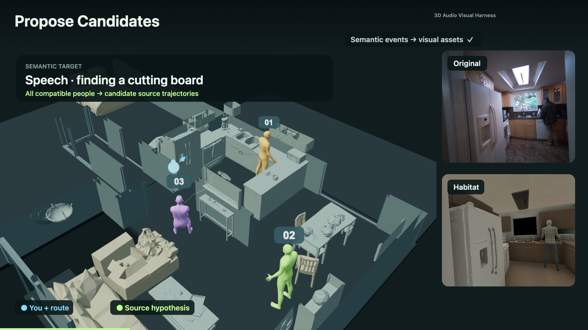
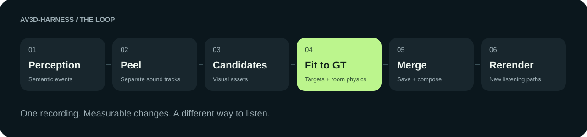
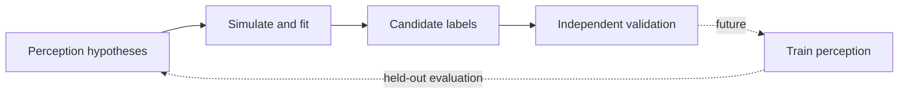

# AV3D-Harness

### You've seen the reconstruction. Now hear it.

**An audio-visual harness for 3D scene perception, real-to-sim reconstruction, and recursive fitting.**

[Watch the demo](docs/demo.mp4) · [Setup](docs/setup.md) · [Run the loop](#run-the-loop) · [Tool contracts](docs/contracts.md) · [Agent instructions](AGENTS.md)

[](docs/demo.mp4)

A room can look right and still sound wrong. Put a voice beside the wrong person,
make the walls too reflective, or move the listener without changing the acoustics,
and the illusion breaks.

AV3D-Harness turns that gap into a loop an agent can operate: **describe what happened,
propose where it happened, render a hypothesis, measure the difference, and try again.**
The output is a scene you can listen to from a different path—and a trace of how the
system chose its source and acoustic parameters.

This repository contains the tools behind the demo, a standalone artifact-based
runner, and the HTML-to-video presentation. The default path uses **semantic perception, semantic audio separation,
physical simulation, and transparent energy metrics**. Each stage saves inspectable artifacts.

## How the framework works

AV3D-Harness connects **perception tools**, a **3D acoustic simulator**, and an
**evaluation loop** through explicit file contracts. An agent can run each stage,
inspect its outputs, and compare another hypothesis using the same reference audio.



**Inputs:** a recording, a reconstructed scene, registered camera/listener poses,
and visual assets with world-space trajectories. Scene reconstruction is upstream;
our [Habitat importer](#bring-your-reconstructed-scene) packages an exported GLB.

| Module | What it does | Output |
|---|---|---|
| **Perception** | Describe audible events and their original-clock intervals | Timed semantics and uncertainty |
| **Semantic peel** | Use an event description to separate audio; review both tracks | Target, residual and selected source layer |
| **Propose** | Match semantics to compatible visual assets; define a bounded search | Candidate source trajectories and acoustic parameter pool |
| **Simulate** | Query room acoustics for a source/listener pair and convolve the source audio | Binaural RIRs and rendered stereo audio |
| **Evaluate & fit** | Compare each render with the reference; select source/material and fit shared gain | Ranked alternatives, accepted parameters and metrics |
| **Merge & rerender** | Hold the fitted source state fixed and change the listener route | Synchronized route videos and distinct binaural audio |
| **Export labels** | Save the fitted trajectory with its evidence and unresolved checks | Candidate supervision for independent validation |

### What makes it a harness?

The **runner** coordinates proposals, fitting and label export. **Tool adapters**
handle perception, separation, simulation and media export. **Artifacts** connect
these pieces: explicit timestamps, coordinate frames, input hashes and failure
receipts let an agent inspect an attempt before choosing the next action.

The fitting loop is **propose → simulate → compare → select**. A changed material
needs new simulator queries; a gain change can reuse the same linear room response.
The current implementation evaluates a declared candidate pool and keeps the best
measured hypothesis. It also exports candidate labels; training a perception model
from those labels is not implemented in this release.

[Environment setup](docs/setup.md) · [Artifact contracts](docs/contracts.md) ·
[Agent operating guide](AGENTS.md) · [Reproduction walkthrough](docs/reproduce.md)

## One sentence. Three possible sources. A different walk through the room.

The demo follows one 3.2-second moment: someone asks about finding a cutting board.
We keep that same moment throughout, so you can hear what each change actually does.

**Video source: Nymeria-Plus.**

The film opens with 4 seconds of silent original footage with the project title and introduction. Then the original
recording and reconstructed Habitat scene play together. A timed semantic
caption appears on the recording clock. Peel uses semantic descriptions to separate the recording into audio tracks.
In this example, it removes a clothing-rustle
component; the retained speech layer is played directly. We chose this route because
direct speech extraction dropped words in this quiet phrase. The retained layer still
contains room background—it is a useful rendering proxy, not a recovered dry voice.

Next, the semantic event **speech** matches the **person** class in the supplied visual
assets. All three people remain candidate emitters. Their 3D asset trajectories give
us a location pool; semantics does not secretly give us an audio direction or identify
the speaker. A bounded parameter pool controls absorption and source strength.

The harness compares the actual binaural renders against the original excerpt. It
keeps the better measured hypothesis, records the alternatives, then holds the fitted
source fixed while the listener takes three different routes. The ending plays those
routes **one at a time**, with the active view highlighted. Headphones recommended.

## What is actually optimized?

The first evaluator is intentionally small:

- **Energy:** per-ear RMS level error against the reference, in dB.
- **Left/right balance:** mean absolute interaural level difference (ILD) error over
  250ms windows, in dB.
- **Selection objective:** channel-energy MAE + ILD MAE, with equal fixed weights.

One global source gain is fitted within **0.25–4×**, shared by both ears and the whole
clip. There is no per-frame loudness correction, independent ear gain, reference-audio
mixing, or hidden time alignment. Spectrum and ITD are saved as diagnostics, not used
to choose this demo's winner. ILD is an audio-balance measure, not angular accuracy.

In the current recorded replay, source 01 → source 03 reduces ILD mismatch from
**4.84 → 2.46 dB**. The energy evaluator keeps absorption **0.8** over the tested **0.1**
alternative and fits source gain to **3.94×**, reaching approximately **0 dB total RMS
gap**. This is agreement with the fitting excerpt, not held-out physical validation.

The cached pool contains three source placements at absorption 0.8 and source03 at
0.1. The other two material combinations are explicitly **not run**. The live pool
renderer can dispatch the full bounded Cartesian product; we do not call a partial
cached search exhaustive. [Recorded results](examples/corey/results.json).

## Bring your reconstructed scene

Start with a scene built by your preferred reconstruction workflow. These community
projects are useful references:

- [AHa-3D](https://github.com/KevinXu02/aha-3d): agentic indoor video-to-Blender reconstruction with Astra.
- [Codex and Blender](https://github.com/danielsobrado/Codex-and-Blender): reproducible CLI, Python and MCP workflows for building Blender scenes.
- [Awesome Astra Embodied AI](https://github.com/zjwzcx/Awesome-Astra-Embodied-AI): a community index of reconstruction and robotics examples.

Export the static environment as **GLB**, in meters with **+Y up**, then package it for Habitat:

```bash
python scripts/import_scene.py --mesh /path/to/room.glb --output inputs/scene
```

This creates the stage configuration, scene bundle and integrity hashes used by our
acoustic renderer. Supply registered listener poses and source assets separately.
The importer packages mesh geometry; it does not infer scale, recover articulation,
create a navmesh or reconstruct a scene from video. Upstream Astra workflows are
references, not bundled or automatically executed integrations.

## Run the loop

Python 3.10+ and FFmpeg are needed. The lightweight replay/evaluation environment does
not need CUDA, API credentials, separation weights, simulator binaries, or a learned perception model.

```bash
python -m venv .venv
source .venv/bin/activate
pip install -r requirements.txt
python -m unittest discover -s tests -v
```

**Bring the input artifact pack first.** Raw recordings, original scene assets,
model weights and large IR archives are not bundled with the Git source. Their
licenses remain separate. See [the input pack and live-tool walkthrough](docs/reproduce.md)
for exact filenames, preparation and commands. There is no automatic dataset download.

With a prepared pack at `inputs/corey`:

```bash
python scripts/harness.py init --inputs inputs/corey --run runs/my-first-fit
python scripts/harness.py propose --run runs/my-first-fit
python scripts/harness.py fit --run runs/my-first-fit
python scripts/harness.py label --run runs/my-first-fit
python scripts/harness.py status --run runs/my-first-fit
```

Read `runs/my-first-fit/candidates/pool.json` before rendering, and
`runs/my-first-fit/fit/evaluation.json` after fitting. Failed attempts stay recorded;
changed inputs require a fresh run. To use fresh simulator outputs, pass
`fit --renders runs/new-rirs/renders.json`.

For a pack that includes the demo's visual metadata and media:

```bash
python scripts/build_demo.py --run runs/my-first-fit --output runs/my-first-fit/demo
python scripts/serve_review.py --directory . --port 8894
```

Open `http://127.0.0.1:8894/runs/my-first-fit/demo/`, then click **Play film**.
The page has perception, peel, candidate pool, fitting, benchmark, label and rerender
chapters. [Export the same page to MP4](docs/reproduce.md#export-the-film).

## Built for an agent to operate

```text
av3d-harness/
├── AGENTS.md                 operating rules and acceptance boundaries
├── configs/                  explicit search and simulator parameters
├── lib/                      proposals, DSP, fitting, geometry, receipt utilities
├── scripts/                  one tool per CLI; JSON artifacts between tools
├── skills/                   reusable agent workflow and tool contracts
├── templates/                synchronized canvas/WebAudio demo
├── tests/                    behavior and signal-integrity checks
├── examples/corey/           small result summary, no weights or raw dataset
├── docs/                     walkthrough, architecture, final demo
├── inputs/                   local artifact packs (gitignored)
└── runs/                     immutable attempts and receipts (gitignored)
```

Start with [AGENTS.md](AGENTS.md) and the [reconstruction skill](skills/audio-reconstruction/SKILL.md).
The useful next action is usually obvious from the receipts: a missing caption, an
unreviewed peel, a rejected geometry path, or an acoustic alternative worth testing.
A stopped search is not automatically a solved scene.

## From fitting to better perception

A fitted source trajectory can become a **candidate label** for a perception model.
That creates a path toward recursive self-improvement:



This release implements fitting and candidate-label export. It does **not** claim a
completed training cycle or measured self-improvement. Background in the speech layer,
head/scene registration, speaker identity and independent validation remain open.
Those gaps are useful targets for contributions, not hidden score adjustments.

## Build the next part with us

We would especially welcome sharper source-quality checks, calibrated scene/audio
registration, alternative simulators, offscreen-source proposals, and evaluators that
catch perceptual failures energy metrics miss. A useful contribution includes a small
reproducible input, the changed hypothesis, and before/after evidence. See
[CONTRIBUTING.md](CONTRIBUTING.md).

If you want 3D worlds that can be heard as well as seen, **star the repository to follow
the next demo and tool releases**.

Code currently uses the repository's existing [Apache-2.0 license](LICENSE).
[Third-party models, recordings, assets and renderer dependencies](THIRD_PARTY.md)
retain their own terms.
